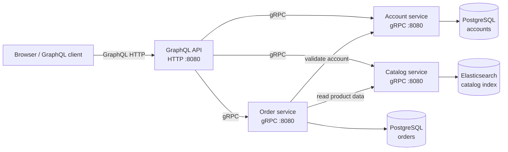

# Go Microservices

A small Go microservices application for managing accounts, products, and
orders. The services communicate over gRPC, and a GraphQL gateway exposes them
over HTTP. Docker Compose runs the complete stack for local development.

## Architecture



The account service owns account data. The catalog service stores and searches
products in Elasticsearch. The order service stores orders and their product
IDs and quantities in PostgreSQL; when creating an order it validates the
account and retrieves product information from the other services. The
GraphQL gateway combines these service APIs for clients.

## Services and endpoints

| Component | Purpose | Local endpoint |
| --- | --- | --- |
| GraphQL | HTTP API and interactive GraphQL Playground | `http://localhost:8080/graphql`, `http://localhost:8080/playground` |
| Account | Create and query accounts over gRPC | `localhost:8081` |
| Catalog | Create, query, and search products over gRPC | `localhost:8082` |
| Order | Create orders and query orders by account over gRPC | `localhost:8083` |
| Elasticsearch | Catalog product storage | `http://localhost:9200` |
| Account PostgreSQL | Account storage | Internal to the Compose network |
| Order PostgreSQL | Order storage | Internal to the Compose network |

The GraphQL and gRPC endpoints above are published on the host's loopback
interface by Compose. Within the Compose network, services use the service
names (`account`, `catalog`, `order`, and `catalog_db`) and container port
`8080` for gRPC.

## Run the full stack with Docker Compose

Requirements: Docker Engine and the Docker Compose plugin. Elasticsearch also
requires the host to permit a virtual memory map count of at least `262144`.
On Linux, set it with:

```sh
sudo sysctl -w vm.max_map_count=262144
```

From the repository root, build and start the services:

```sh
docker compose up --build
```

Open `http://localhost:8080/playground` to explore the GraphQL API. To stop the
stack, press `Ctrl+C`, then run:

```sh
docker compose down
```

PostgreSQL and Elasticsearch data is persisted in named Docker volumes. To
remove the stack **and permanently delete its persisted data**, run
`docker compose down -v`.

The Compose file currently uses development database credentials. Do not reuse
them in a shared or production environment.

## Run the GraphQL gateway from Go

The backend services must be reachable before starting the gateway. One way to
run them is to start the Compose stack, then run the gateway on the host from
the repository root:

```sh
docker compose up -d account catalog order
ACCOUNT_SERVICE_URL=localhost:8081 \
CATALOG_SERVICE_URL=localhost:8082 \
ORDER_SERVICE_URL=localhost:8083 \
go run ./graphql
```

When running the gateway directly on the host, use the published host
addresses, not Compose-only DNS names such as `account:8080`. The Go toolchain
version declared by the module is Go 1.26.5.

## GraphQL examples

Run create mutations before creating an order, and use the returned account
and product IDs. See [queries.md](./queries.md) for copyable examples covering
account and product creation, listing and search, order creation, and fetching
an account with its orders.

## Repository layout

```text
account/       Account gRPC service, PostgreSQL repository, and schema
catalog/       Catalog gRPC service, Elasticsearch repository, and schema
order/         Order gRPC service, PostgreSQL repository, and schema
graphql/       GraphQL HTTP gateway, schema, resolvers, and generated code
docker-compose.yaml
               Local multi-service development environment
queries.md     GraphQL test operations
```

The `.proto` files define the gRPC APIs. Their generated Go code lives in each
service's `pb/` directory. PostgreSQL initialization scripts are in
`account/up.sql` and `order/up.sql` and are applied when their database volumes
are first created.
